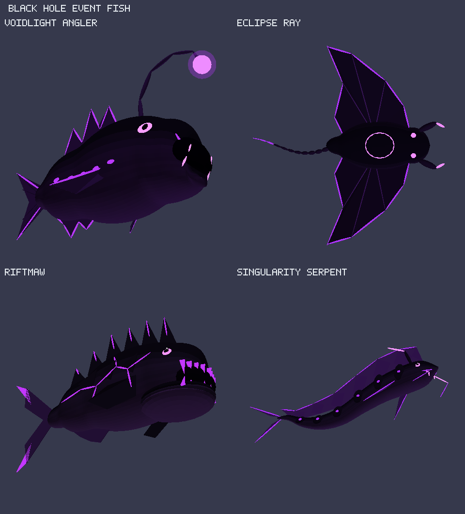

# Black hole fish

Four fantasy species share near-black bodies and intrinsic neon violet accents, with distinct silhouettes:



The preview uses the real model builders, smooth loft rings and color bands. Software rendering approximates the shapes; Studio lighting and bloom are not shown.

| Species | Tier | Design | Weight kg (min / average / max) | Average base value |
|---|---|---|---|---|
| Voidlight Angler | Legendary | Squat predator, curved lantern, needle fangs and torn fins | 2 / 9 / 75 | $1,250 |
| Eclipse Ray | Mythical | Swept crescent wings, violet rim, horn tips and an eclipse orbit | 6 / 28 / 220 | $2,400 |
| Riftmaw | Exotic | Armored jaw, crystal fangs, dorsal shards and glowing fissures | 18 / 70 / 500 | $4,600 |
| Singularity Serpent | Divine | Curved eel body, dorsal ribbon, whiskers and comet tail | 35 / 150 / 1,200 | $9,000 |

Each module requires `BlackHole`, supports all four seasons and joins `OpenSea`, which every regional pool inherits. The existing server catch filter admits them only while the validated black hole event is active, in daytime or at night. Their bestiary condition label is `All year (black hole)`. Catch rules use the event's global weather; they do not impose the smaller Void Touched radius.

Within that radius, `VoidTouched` still blackens the body and added corruptions and supplies the distortion aura. Only parts explicitly tagged `BlackHoleAccent` retain their native purple neon color, material and transparency. Other species retain their existing fully black Void Touched appearance. These are intrinsic species features, separate from the randomly rolled Neon mutation.

Models use local geometry and the existing smooth skin pipeline, with visible part fallbacks. They need no uploaded meshes or textures. Cargo shapes, weight ranges, values and fight modifiers are defined with each species in `src/shared/Fish`.

## Verification

```powershell
$env:LUTE = 'C:/Users/ayden/.lute/bin/lute.exe'
node scripts/check-blackhole-fish.mjs
node scripts/check-fish-models.mjs
node scripts/check-fish-meshes.mjs
```

The focused check covers event eligibility, weighted catches, cargo geometry and appearance under Void Touched. Recording doubles verify geometry and behavior; Studio play testing is still needed for final lighting, smooth skins and device appearance.

Verified: the focused check passes 11,556 assertions across four species and 784 ordinary-weather combinations; all 121 catalog models build visible fallback geometry; mesh allocation and fallback checks pass. Two older harnesses remain blocked by existing fixture drift: `check-weather.mjs` expects Harbour `SCALE = 0.85` (currently `1`), and `check-blackhole-catches.mjs` lacks a `BackpackCatalog.layoutFor` mock.
